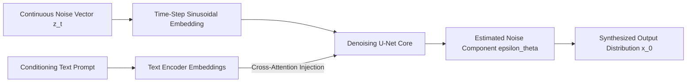

<p align="center">
  
</p>

<p align="center">
  
  
  
  
</p>

<a id="overview"></a>
## 📖 Executive Summary & Overview

The evolution of modern Generative AI relies on mathematically rigorous architectures capable of learning high-dimensional manifolds: Denoising Diffusion Probabilistic Models (DDPM), Variational Autoencoders (VAEs), and Multi-Head Cross-Attention Transformers.

The **Generative AI Architectures** repository serves as a foundational knowledge base and architectural reference for generative modeling paradigms. It encapsulates core mathematical equations, loss formulations (ELBO, Adversarial Minimax, Denoising Score Matching), and implementation blueprints for synthetic media generation.

<a id="toc"></a>
## 📑 Table of Contents

- [📖 Executive Summary & Overview](#overview)
- [🎯 Key Features & Capabilities](#features)
- [🏗️ System Architecture & Pipeline](#architecture)
- [🛠️ Tech Stack Breakdown](#tech-stack)
- [⚙️ Reproducible Quickstart & Setup](#setup)
- [📁 Project Directory Layout](#project-layout)
- [👨‍💻 Author & Contributions](#author)

<a id="features"></a>
## 🎯 Key Features & Capabilities

- **Mathematical Foundations:** Formal documentation of Variational Lower Bounds (ELBO), Markov forward diffusion transitions, and reverse score matching.
- **Architectural Reference Blueprints:** U-Net backbones with time-step sinusoidal embeddings and attention mechanisms.
- **Conditioning Mechanisms:** Cross-attention token injection for text-to-image and multimodal guidance.
- **Evaluation Methodologies:** Metric specifications for Inception Score (IS), Fréchet Inception Distance (FID), and BLEU/Perplexity for text.

<a id="architecture"></a>
## 🏗️ System Architecture & Pipeline



<a id="tech-stack"></a>
## 🛠️ Tech Stack Breakdown

| Area | Technologies | Application |
| :--- | :--- | :--- |
| **Frameworks** | PyTorch, HuggingFace Diffusers | Model building and execution |
| **Mathematical Paradigms** | Score-Based Diffusion, VAE, Transformers | Core generative algorithms |
| **Compute Acceleration** | CUDA, cuDNN | High-throughput tensor calculations |
| **Documentation** | LaTeX, Mermaid, Markdown | Theoretical blueprints and flow specifications |

<a id="setup"></a>
## ⚙️ Reproducible Quickstart & Setup

```bash
# 1. Clone repository
git clone https://github.com/Amaraiah11/Genrative_AI.git
cd Genrative_AI

# 2. Inspect architectural documentation and reference blueprints
```

<a id="project-layout"></a>
## 📁 Project Directory Layout

```text
Genrative_AI/
└── README.md          # Architectural blueprints and generative modeling reference
```

<a id="author"></a>
## 👨‍💻 Author & Contributions

This project is developed and maintained with high technical rigour by **Amaraiah C**, Software Engineer and Data Analytics Practitioner studying Bachelor of Computer Applications (BCA) at Alliance University.

- 🌐 **GitHub:** [@Amaraiah11](https://github.com/Amaraiah11)
- 💼 **LinkedIn:** [Connect on LinkedIn](https://www.linkedin.com/in/amaraiah-c/)
- 📧 **Institutional Contact:** `camaraiahBCA24@ced.alliance.edu.in`

### 🤝 Contribution Guidelines
Contributions, bug reports, and architectural discussions are welcome!
1. **Fork** the repository: `https://github.com/Amaraiah11/Genrative_AI`
2. **Branch**: `git checkout -b feature/your-feature-name`
3. **Commit**: `git commit -m "feat: enhance feature logic"`
4. **Push**: `git push origin feature/your-feature-name`
5. **Open Pull Request** against the `Amaraiah-C` branch.

---

<p align="center">
  <b>⭐ If this codebase or documentation assisted your engineering workflows, please star the repository! ⭐</b>
</p>

<p align="center">
  
</p>
