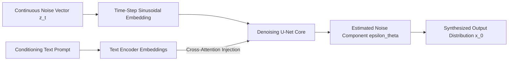

# 🌌 Generative AI Architectures — Foundational Latent Diffusion & Transformer Models

<p align="center">
  
</p>

<p align="center">
  <b>Mathematical Foundations and Architectural Blueprints: Denoising Diffusion Probabilistic Models (DDPM), Variational Autoencoders (VAEs), and Multi-Head Cross-Attention.</b>
</p>

<p align="center">
  
  
  
  
</p>

<p align="center">
  
</p>

---

<a id="table-of-contents"></a>
## 📌 Table of Contents

- [📖 Executive Summary & Overview](#executive-summary--overview)
- [🎯 Key Features & Capabilities](#features)
- [🏗️ System Architecture & Pipeline](#system-architecture--pipeline)
- [🛠️ Tech Stack Breakdown](#tech-stack-breakdown)
- [⚙️ Reproducible Quickstart & Setup](#setup)
- [📁 Project Directory Layout](#project-layout)
- [🔮 Future Improvements & Roadmap](#future-improvements--roadmap)
- [🤝 Contributing Guidelines](#contributing-guidelines)
- [👨‍💻 Author & Contributions](#author--contributions)

---

<a id="executive-summary--overview"></a>
## 📖 Executive Summary & Overview

Modern Generative AI architectures rely on rigorous mathematical formulations to model complex probability distributions: Denoising Diffusion Probabilistic Models (DDPM), Score-Based Generative Models, and Cross-Attention Transformers.

The **Generative AI Architectures** repository serves as an architectural reference and knowledge base, providing formal equations, loss formulations (ELBO, Score Matching, Minimax Objectives), and blueprints for generative systems.

---

<a id="key-features--capabilities"></a>
## 🎯 Key Features & Capabilities

### 🌊 1. Diffusion Models Mathematical Modeling
- Forward Markov diffusion chains: $q(\mathbf{x}_t | \mathbf{x}_{t-1}) = \mathcal{N}(\mathbf{x}_t; \sqrt{1 - \beta_t}\mathbf{x}_{t-1}, \beta_t \mathbf{I})$.
- Reverse denoising transitions parameterized by U-Net neural backbones.

### 🔀 2. Multimodal Conditioning
- Cross-attention mechanisms mapping conditioning vectors (text prompt embeddings via CLIP) into spatial feature representations.

---

<a id="system-architecture--pipeline"></a>
## 🏗️ System Architecture & Pipeline



---

<a id="tech-stack-breakdown"></a>
## 🛠️ Tech Stack Breakdown

| Area | Technologies | Application |
| :--- | :--- | :--- |
| **Frameworks** | PyTorch, HuggingFace Diffusers | Model building and execution |
| **Mathematical Paradigms** | Score-Based Diffusion, VAE, Transformers | Core generative algorithms |
| **Compute Acceleration** | CUDA, cuDNN | High-throughput tensor calculations |

---

<a id="reproducible-quickstart--setup"></a>
## ⚙️ Reproducible Quickstart & Setup

```bash
# 1. Clone repository
git clone https://github.com/Amaraiah11/Genrative_AI.git
cd Genrative_AI

# 2. Inspect architectural documentation and reference blueprints
```

---

<a id="project-directory-layout"></a>
## 📁 Project Directory Layout

```text
Genrative_AI/
└── README.md          # Architectural blueprints and generative modeling reference
```

---

<a id="future-improvements--roadmap"></a>
## 🔮 Future Improvements & Roadmap

- [ ] Add PyTorch implementation of a 1D toy diffusion model with step-by-step denoising animations.
- [ ] Include mathematical derivations of Classifier-Free Guidance (CFG).

---

<a id="author--contributions"></a>
## 👨‍💻 Author & Contributions

This project is developed and maintained with rigorous engineering standards by **Amaraiah C**, Software Developer and Applied Data Analytics Practitioner studying Bachelor of Computer Applications (BCA) at Alliance University, Bangalore.

- 🌐 **GitHub Profile:** [@Amaraiah11](https://github.com/Amaraiah11)
- 💼 **LinkedIn Profile:** [Connect on LinkedIn](https://www.linkedin.com/in/amaraiah-c/)
- 📧 **Institutional Email:** `camaraiahBCA24@ced.alliance.edu.in`

### 🤝 Contributing Guidelines
Contributions, bug reports, and architectural discussions are welcome!
1. **Fork** the repository: `https://github.com/Amaraiah11/Genrative_AI`
2. **Create a Feature Branch:**
   ```bash
   git checkout -b feature/your-feature-name
   ```
3. **Commit Your Enhancements:**
   ```bash
   git commit -m "feat: enhance feature logic"
   ```
4. **Push to Your Branch:**
   ```bash
   git push origin feature/your-feature-name
   ```
5. **Open a Pull Request** against the `Amaraiah-C` branch.

---

<p align="center">
  <b>⭐ If this codebase or documentation assisted your engineering workflows, please star the repository! ⭐</b>
</p>

<p align="center">
  
</p>
